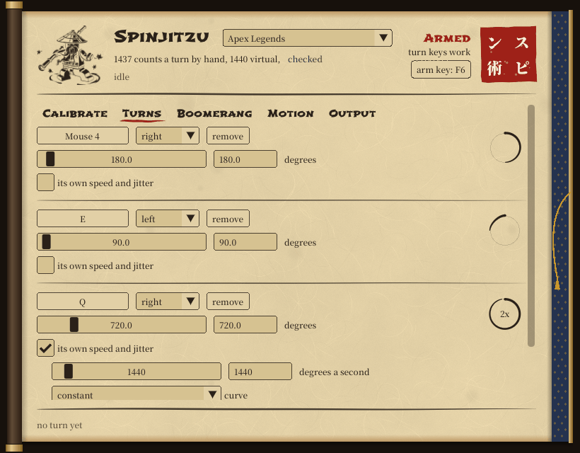
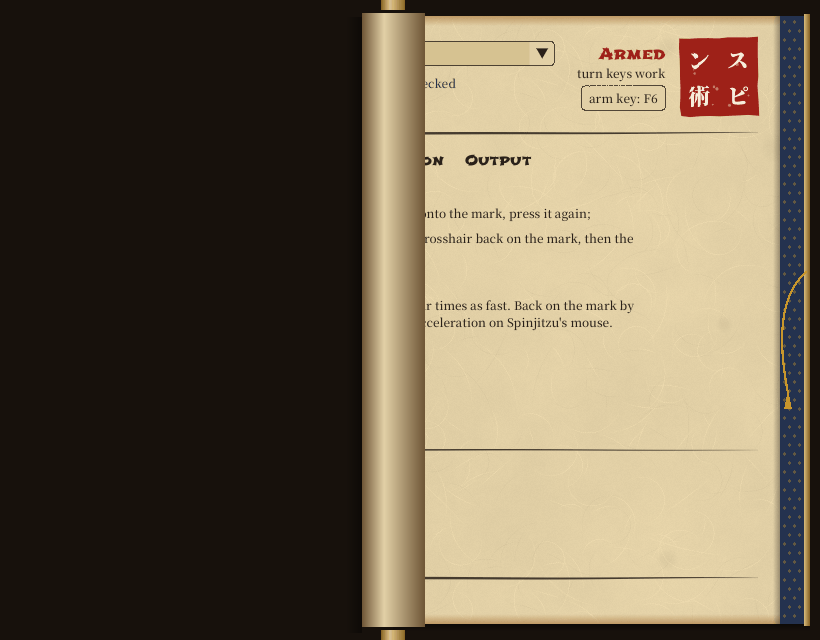
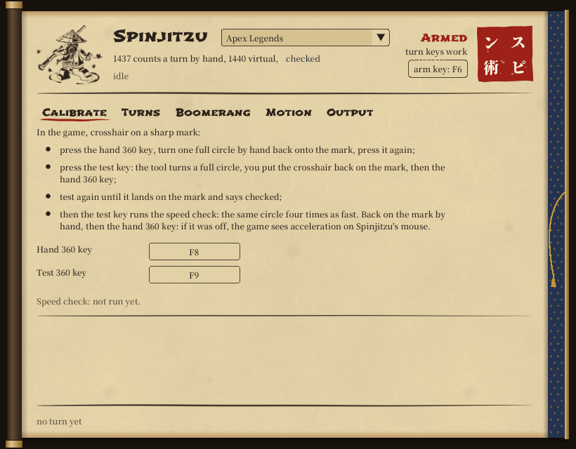
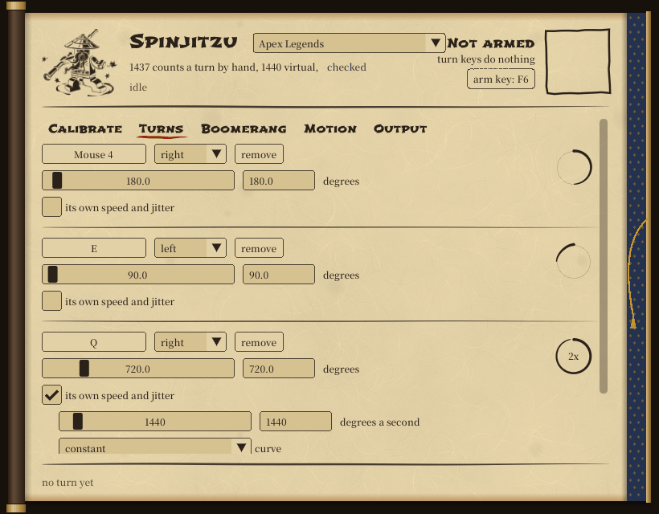
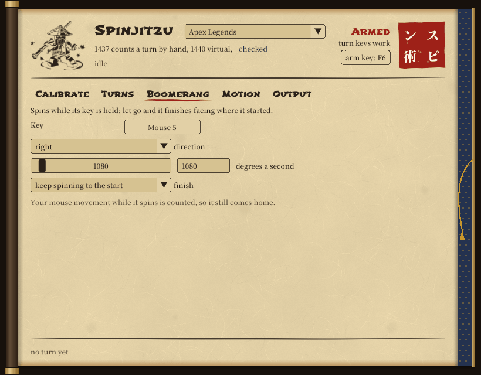
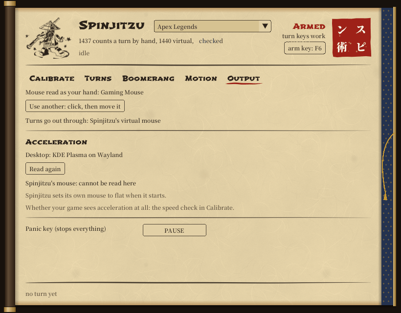
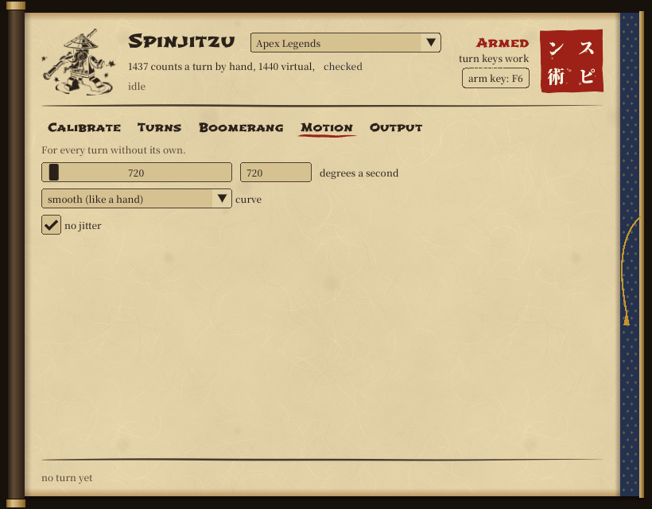

<p align="center">
  
</p>

<h1 align="center">Spinjitzu スピン術</h1>

<p align="center">Turn your view in any game by an exact angle, with one key. For Linux.</p>

<p align="center">
  
</p>

Spinjitzu learns how many mouse counts make one full turn in your game. After
that, any key or mouse button can turn you exactly 180, 90 or 7.5 degrees, as
smoothly or as fast as you like. Think of the "perfect 360" button some gaming
mice have, but free, open, and working with the mouse you already own.

Four 90s make exactly one full turn, and odd angles add up too, so there is no
drift however many turns you make. Keep your hand still while a turn runs:
anything your hand does in that time is added to the turn.

Besides fixed turns there is the boomerang: hold a key to spin, let go and it
finishes facing where you started, even if you moved the mouse while it spun.
Each game gets its own profile with its own calibration. Turns can be smooth
like a hand or constant, with some jitter if you want them to look less
mechanical. Nothing turns until you arm it, and you can bind a key to arm and
disarm from inside the game.

> Some online games forbid tools that move the mouse for you. Check your
> game's rules before using it there.

Tested on CachyOS with KDE Plasma 6 on Wayland, raylib 6.0 and GCC 16. Other
distributions and desktops should work but have not been tried; the notes for
them below follow each tool's documentation.

## What you need

Linux with a desktop. The window is an X11 window, so on Wayland it runs
through XWayland, which nearly every Wayland desktop has. To build it you need
a C++20 compiler, CMake 3.18 or newer, pkg-config, git, libevdev and
[raylib](https://www.raylib.com) (tested with 6.0).

- Arch, CachyOS, Manjaro: `sudo pacman -S --needed base-devel git cmake raylib libevdev`
- Fedora: `sudo dnf install gcc-c++ git cmake pkgconf-pkg-config raylib-devel libevdev-devel`
- Debian, Ubuntu: `sudo apt install build-essential git cmake pkg-config libevdev-dev`, plus raylib

Debian and Ubuntu may ship an older raylib or none. Build it as a shared
library so Spinjitzu links against it without extra flags:

```sh
git clone --depth 1 https://github.com/raysan5/raylib
cmake -S raylib -B raylib/build -DBUILD_SHARED_LIBS=ON
cmake --build raylib/build -j && sudo cmake --install raylib/build && sudo ldconfig
```

If CMake later says it cannot find raylib, run `pkg-config --modversion raylib`.
No version printed means raylib is not installed where pkg-config looks.

Dear ImGui and rlImGui come with the source, in `third_party/`.

## Build

```sh
git clone https://github.com/Ymsniper/spinjitzu.git
cd spinjitzu
cmake -S . -B build
cmake --build build -j
./build/spinjitzu
```

The fonts and the logo are built into the binary, so `build/spinjitzu` runs
from anywhere. Copy it to `~/.local/bin` if you like.

## Permissions, once

Spinjitzu reads your keyboard and mouse directly, so its keys work while the
game has focus. That needs the `input` group. It turns you through a virtual
mouse of its own, which needs access to `/dev/uinput`.

> Know what you are granting. Being in the `input` group lets any program you
> run read every key you press, passwords included. Access to `/dev/uinput`
> lets a program press keys and move the mouse as you. Spinjitzu only reads
> keys and moves its own mouse, and the source is here to check, but the
> access is not limited to Spinjitzu.

```sh
# read keyboards and mice
sudo usermod -aG input $USER

# the virtual mouse: load uinput now and at every boot...
sudo modprobe uinput
echo uinput | sudo tee /etc/modules-load.d/uinput.conf

# ...and let the person at the computer use it (the same rule Steam uses)
echo 'KERNEL=="uinput", SUBSYSTEM=="misc", TAG+="uaccess", OPTIONS+="static_node=uinput"' | \
    sudo tee /etc/udev/rules.d/60-spinjitzu-uinput.rules
sudo udevadm control --reload-rules && sudo udevadm trigger --name-match=uinput
```

Then reboot. Logging out and back in is not always enough, the session can
hang on to its old groups for a while. To check:

```sh
id -nG | tr ' ' '\n' | grep -x input        # prints: input
getfacl -p /dev/uinput | grep "user:$USER"  # prints a line ending in rw-
```

Without systemd-logind there is no `uaccess`; use a group instead:
`sudo groupadd -f uinput && sudo usermod -aG uinput $USER`, with the rule
`KERNEL=="uinput", GROUP="uinput", MODE="0660", OPTIONS+="static_node=uinput"`.

Spinjitzu never grabs your devices, so every key you press still reaches the
game. Bind keys the game does not use.

## Check it works

Start `./build/spinjitzu`. The scroll unrolls, then the header shows the
title, "Not calibrated" and the seal. If there is no red text under the title,
the permissions are fine. If something is missing, the red text says what and
gives the command that fixes it.

Then calibrate (below), add a turn on the Turns tab with a key like `E`, click
the seal so it shows red, click into a game and press `E`. The view turns
around. Pressing it in the Spinjitzu window does nothing, on purpose: turn
keys only work while something else has the keyboard.

## First run

<p align="center">
  
</p>

The scroll unrolls when Spinjitzu starts. A key or a click skips it. On KDE
and GNOME it does not play at all when the desktop's animations are off.

### Calibrate

Do this in the game, with the crosshair on something sharp: a corner, a pole,
a window edge. The calibrate and test keys work whether or not Spinjitzu is
armed.

<p align="center">
  
</p>

1. Press F8, turn one full circle by hand until the crosshair is back on the
   mark, and press F8 again. Overshooting and correcting is fine, wherever you
   stop counts as exactly 360.
2. Press F9 and Spinjitzu turns a full circle by itself. Put the crosshair back
   on the mark by hand and press F8. It corrects itself from how far you had to
   move.
3. Repeat F9 until it lands on the mark and the header says checked.
4. Press F9 once more for the speed check, the same circle four times as fast.
   Back on the mark, then F8. If it lands, your game does not see mouse
   acceleration and every speed is exact. If it does not, see
   [mouse acceleration](#mouse-acceleration-and-your-desktop).

Calibrate again when you change your in-game sensitivity, your mouse's DPI, or
your field of view in games where that changes the turn rate.

### Bind turns

On the Turns tab, "+ Add turn", then press the key or mouse button it should
use. Set the degrees and the direction. The brush circle at the end of each row
shows the turn, drawn from the top, as far as it goes, clockwise for right.
Tick "its own speed and jitter" to give one turn a motion of its own; the rest
use the Motion tab.

### Arm

<p align="center">
  
</p>

Click the seal at the top right. Armed, it stamps red with スピン術. Not armed,
it is an empty ink frame and turn keys do nothing. The arm key button sits
under the words next to the seal; bind one to arm and disarm from inside the
game, say before typing in chat. The window title says armed or not, so the
taskbar shows it too.

Turn and boomerang keys also do nothing while Spinjitzu's own window has the
keyboard, so typing a profile name never turns anything. Click back into the
game.

### Boomerang

<p align="center">
  
</p>

Bind a key and pick the direction and spin speed. Hold it to spin, let go and
it finishes facing where it started. "Keep spinning to the start" carries on
forward; "shortest way back" takes the nearer way. Mouse movement while it
spins is counted, so it still comes home.

## Profiles

Every game turns by its own number of counts, so every game needs its own
calibration. The menu next to the title holds one profile per game. Pick one
to switch to it. "New profile" keeps your turns, boomerang and motion but
starts uncalibrated, and asks for a name. Rename takes Enter to keep and Esc to
cancel. Delete asks first and never deletes the last profile.

The calibrate, test, panic and arm keys, Armed and your mouse are shared by all
profiles. The menu is greyed out while a turn or a calibration runs, or while
Spinjitzu waits for a key to bind. The window title names the profile in use.

Settings live in `~/.config/spinjitzu/spinjitzu.cfg` (or under
`$XDG_CONFIG_HOME`) and save themselves. A settings file from before profiles
becomes the profile "Default", and the old file is kept next to it as
`spinjitzu.cfg.before-profiles`.

## Mouse acceleration and your desktop

<p align="center">
  
</p>

If your desktop accelerates Spinjitzu's virtual mouse and your game reads the
accelerated pointer, a fast turn goes further than a slow one. The speed check
tells you whether that happens in your game. Plenty of games read raw mouse
input and never see acceleration at all.

Spinjitzu creates its virtual mouse fresh at every start, so a setting made by
hand only lasts until it closes. These make it stick:

- KDE Plasma on Wayland (tested): nothing to do. Spinjitzu sets its own mouse
  to flat at every start and leaves your real mouse alone.
- X11, any desktop (untested): the Output tab shows an `xinput` command with a
  Copy button, good until Spinjitzu closes. To keep it, put this in
  `/etc/X11/xorg.conf.d/50-spinjitzu.conf`:
  ```
  Section "InputClass"
      Identifier "spinjitzu flat"
      MatchProduct "spinjitzu"
      Driver "libinput"
      Option "AccelProfile" "flat"
  EndSection
  ```
- Sway (untested): add `input 23063:864:spinjitzu accel_profile flat` to your
  sway config.
- Hyprland (untested): add to `hyprland.conf`:
  ```
  device {
      name = spinjitzu
      accel_profile = flat
  }
  ```
- GNOME (untested): GNOME has a single acceleration setting for every mouse.
  The Output tab shows the command, but it makes your real mouse flat too.
- Anything else: set the device named `spinjitzu` to a flat profile in your
  desktop's mouse settings, if it has one.

## Keys

| Key | Default | Does |
|---|---|---|
| Hand 360 | F8 | starts and ends a hand 360, confirms a correction |
| Test 360 | F9 | Spinjitzu turns a full circle; once checked, the speed check |
| Panic | Pause | stops any turn or spin at once |
| Arm | none | switches Armed from anywhere |

All of them can be rebound. Esc cancels a binding. Left click can't be bound.

## The window

<p align="center">
  
  
</p>

The window is a Japanese handscroll, ink on old paper with a wooden roller and
an indigo brocade cover. Every colour pair that carries text is checked for
contrast, and every control has an ink border so you can't miss one.

## Development

```sh
cmake --build build -j
(cd build && ctest --output-on-failure)
python3 tests/breaks.py     # breaks the code on purpose; every break has to fail a check
python3 tests/glyphs.py     # every character the window shows is in its fonts
cmake -S . -B build-tsan -DSANITIZE=thread && cmake --build build-tsan -j && ./build-tsan/bridge_test
```

`src/engine.hpp` holds the exact maths with no devices in it: calibration, the
drift-free count, motion curves, jitter and the boomerang. `src/core.hpp` is
the app without a window (binds, calibration, turns, Armed, profile switches),
`src/devices.hpp` the input devices, the virtual mouse and the desktops, and
`src/app/` the window plus the worker thread that owns the devices.

`./build/spinjitzu --shot out.png [tab] [seconds] [armed]` draws the window
into a picture without opening any device or writing settings. Tab is 0 to 4
(Calibrate, Turns, Boomerang, Motion, Output), seconds is the time into the
opening (default 100, so it is over), armed is 0 or 1. The screenshots here
come from it. `./build/spike` is a terminal-only calibration check.

How it all behaves is written down in [SPEC.md](SPEC.md).

## Licences

Spinjitzu is GPL-2.0, see [LICENSE](LICENSE). The fonts are
[Shojumaru](assets/fonts/OFL-Shojumaru.txt) by Astigmatic and a subset of
[Noto Serif CJK JP](assets/fonts/OFL-NotoSerifCJK.txt), both under the SIL
Open Font Licence 1.1. [Dear ImGui](third_party/imgui/LICENSE.txt) is MIT and
[rlImGui](third_party/rlImGui/LICENSE) is zlib.

Spinjitzu and Ninjago are trademarks of the LEGO Group. This is a fan-made
tool, not affiliated with or endorsed by LEGO.
